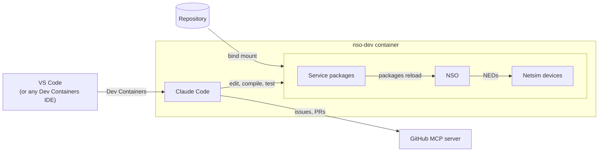
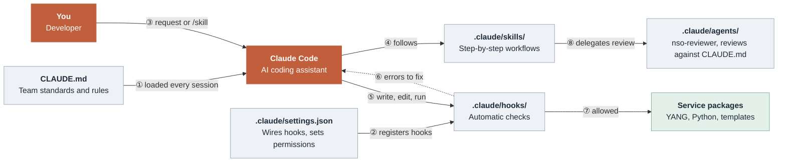

<h1 align="center">🛠️📦 NetOps AI Development Environment<br /><br />

<div align="center">
  
  
  
  
  
  
</div></h1>

A series of tools and recommendations for building standardized, container-based environments tailored for Network Automation development projects.

> This repository consists on an implementation of these principles towards NSO Service Packages. However, if you're working on developing other things, such as Ansible playbooks, OpenTofu modules, etc; you can still benefit from the principles applied in this project.

## ✨ Overview

Join a Network Automation project and start coding services immediately, not after days of wrestling with scattered docs, mismatched libraries, and broken sources.

This project provides:
- 🤝 **Consistent environments**: Same NSO versions, NEDs, and packages for the entire team
- 🚀 **Build once, use many**: Download artifacts once, spin up unlimited containers
- 🚢 **Based on official NSO**: Extends the official container image without modifying it
- 🤖 **AI pair programming with shared rules**: Claude Code reads the team's NSO standards from the repo, enforces them with hooks, and tracks work through the GitHub MCP server

## 📁 What's Included

| File/Directory   | Purpose |
|------------------|---------|
| `.devcontainer/devcontainer.json` | The core of our dev env. Here we specify how to spin it up and what to deploy |
| `Dockerfile` | For building our custom NSO development image |
| `requirements.txt` | Python dependencies to install in our custom NSO development image |
| `artifacts.yaml` | NEDs and other binaries to deploy in our custom NSO development image |
| `docker-compose.yml` | Main container orchestration for the NSO service. To be used by devcontainer.json |
| `docker-compose-override.yml` | Mounting of Makefile and scripts for housekeeping actions when spinning up a new container. To be used by devcontainer.json |
| `bootstrap/` | Pre-configurations for our NSO environment |
| `config/runtime/` | ncs.conf for our NSO environment. This one enables RESTCONF and specifies multiple package locations |
| `source/packages/` | Source tree for custom NSO services (`-cfs`/`-rfs`) |
| `Makefile` | Simple commands to build and manage your environment |
| `scripts/` | Automation bash scripts for build, install, compile, reload, and netsims creation |
| `nso-lab-topology.yaml` | Lab topology definition used for NSO environment setup |
| `CLAUDE.md` | Project memory for Claude Code: NSO coding standards, naming rules, commands and workflow |
| `.claude/settings.json` | Shared Claude Code permissions, enabled MCP servers and hooks |
| `.claude/hooks/` | Automatic checks: package naming, ruff, YANG compilation, YANG/template/Python consistency |
| `.claude/skills/` | `/start-my-day`, `/new-service`, `/reload-packages`, `/test-service`, `/ship-it` |
| `.claude/agents/nso-reviewer.md` | Subagent that reviews packages against the standards and NSO best practices |
| `.mcp.json` | GitHub MCP server for issues, pull requests and the project board |
| `ruff.toml` | Python coding standards as ruff rules (naming, docstrings, type hints) |
| `.github/` | Issue templates and pull request template |

*The runtime config in `config/runtime/ncs.conf` separates NEDs and artifacts (`/opt/ncs/packages`) from your services (`/nso/run/packages`) for a clean development experience.

### 🗺️ Deployed architecture

Once the container is up, this is what runs and how the pieces connect:



Your service code lives on the host and is bind-mounted into the container, so edits made inside it show up as diffs in your repository. NSO, the netsims, Claude Code and the tests all run inside the single `nso-dev` container. Only Claude Code's calls to the Anthropic API and the GitHub MCP server leave your machine.

---

## ✅ Prerequisites

- [Docker](https://docs.docker.com/get-docker/) and [Docker Compose](https://docs.docker.com/compose/install/)
- [Make](https://www.gnu.org/software/make/)
- Linux-based environment (or Linux-compatible container runtime)
- An editor that supports [Dev Containers](https://containers.dev): [VS Code](https://code.visualstudio.com/) with the [Dev Containers extension](https://marketplace.visualstudio.com/items?itemName=ms-vscode-remote.remote-containers) is the supported path. See [Using another editor](#-using-another-editor) for Cursor, Windsurf, JetBrains or the terminal

With your local environment ready, clone and enter the repo

```bash
git clone https://github.com/ponchotitlan/netops-ai-dev-environment
cd nso-consistent-dev-environment
```

## 🏗️ Building and pushing your development NSO Docker image

This repository incorporates tools that allow you to create your own NSO image based on an official foundations one.

First of all, you need your NSO base image deployed locally. If needed, download and load an official NSO image first. In this case, we will use the free trial available at [software.cisco.com](software.cisco.com):

```bash
# Unpack the downloaded signed file
sh nso-6.5-freetrial.container-image-prod.linux.x86_64.signed.bin

# Load into Docker
docker load < nso-6.5.container-image-prod.linux.x86_64.tar.gz

# Verify
docker images | grep cisco-nso-prod
```

Afterwards, you need to fill out the following variables in your `.env` file:

```bash
# NSO images:
# - NSO_BASE: Base NSO image used as the starting point for builds.
# - NSO_IMAGE: Final image name:tag used for local build/run.
NSO_BASE=ghcr.io/ponchotitlan/cisco-nso-prod:6.6
NSO_IMAGE=ghcr.io/ponchotitlan/nso-dev:6.6.1

# Container registry credentials:
# - DOCKER_REGISTRY: Registry URL used to push/pull images.
# - DOCKER_REGISTRY_USER: Registry username.
# - DOCKER_REGISTRY_TOKEN: Registry access token/password.
DOCKER_REGISTRY=your_docker_registry_url_here
DOCKER_REGISTRY_USER=your_docker_registry_username_here
DOCKER_REGISTRY_TOKEN=your_docker_registry_token_here
```

> For the purpose of this demo, we are using `ghcr.io` as our Docker Registry

You also need to provide your artifacts in the file [artifacts.yaml](./artifacts.yaml). These can be either NEDs or other binaries:

```yaml
urls:
  - https://github.com/ponchotitlan/dummy_artefact_repository/releases/download/iosxr6.6/ncs-6.6-cisco-iosxr-7.74.4.tar.gz
  - https://github.com/ponchotitlan/dummy_artefact_repository/releases/download/ios6.6/ncs-6.6-cisco-ios-6.110.3.tar.gz
  - https://github.com/ponchotitlan/dummy_artefact_repository/releases/download/asa6.6/ncs-6.6-cisco-asa-6.18.29.tar.gz
```

Furthermore, you need to provide the Python libraries that you will ned in the [requirements.txt](./requirements.txt) file:

```text
argcomplete==3.5.3
Jinja2==3.1.5
MarkupSafe==3.0.2
pyaml==25.1.0
PyYAML==6.0.2
tomlkit==0.13.2
xmltodict==0.14.2
yq==3.4.3
robotframework==7.2.2
RESTinstance==1.3.0
robotframework-jsonlibrary==0.5
ruff==0.16.9
```

> In our case, we are providing the libraries needed to support `Robot Framework` inside of our container, plus `ruff`, which Claude Code's hooks use to enforce the coding standards.

Finally, issue the following command in the root location of this repository:

```bash
make build-push 
```

This will build your custom NSO image using the [Dockerfile](./Dockerfile) in this repository, to then push the image using the information provided in the variables `DOCKER_REGISTRY`, `DOCKER_REGISTRY_USER` and `DOCKER_REGISTRY_TOKEN`.

### 🐳 About the `Dockerfile`

This Dockerfile does the following:

1. Pull the base image specified in `NSO_BASE`.
2. Install the Python libraries mentioned in the `requirements.txt` file using `pip`.
3. Download the artifacts mentioned in the URLs of the file `artifacts.yaml`.
4. Extract the artifacts in the folder `opt/ncs/packages` of the NSO container. This folder is enabled for NSO packages as per the `ncs.conf` file in this repository
5. Delete all these support files once everything is set and done

---

## 🚀 Deploying your development environment

To get started, provide the following values in the variables of the `.env` file:

```bash
# NSO access and exposed ports:
# - ADMIN_USERNAME: NSO admin login username.
# - ADMIN_PASSWORD: NSO admin login password.
# - NSO_HTTP_PORT: Host port mapped to NSO HTTP.
# - NSO_SSH_PORT: Host port mapped to NSO SSH.
ADMIN_USERNAME=admin
ADMIN_PASSWORD=admin
NSO_HTTP_PORT=8080
NSO_SSH_PORT=2022

# GitHub MCP server (project management from Claude Code):
# - GITHUB_PAT: Fine-grained token with read/write on Issues, Pull requests and Projects.
GITHUB_PAT=your_github_token_here
```

Also, specify in the file [nso-lab-topology.yaml](./nso-lab-topology.yaml) which netsim devices you will spin inside of your NSO container following this format:

```yaml
topology:
  cisco-iosxr-cli:
    ned_version: "7.74.4"
    netsims:
      - asr9k-xr-7601
      - ncs5k-xr-5702
```

> The NED name and version must match any of the artifacts installed in your custom image, as mentioned in the file [artifacts.yaml](./artifacts.yaml).

Finally, on your VS Code IDE, press `Ctrl + Shift + P` (`Cmd + Shift + P` on macOS). In the pop-up window, select the option **Dev Containers: Reopen in Container**:


This will close your current IDE window and open a new one that launches the NSO container and your development environment. You can see the progress in the terminal console:


Once done, the environment is all yours for usage!

> **This process will happen only once: when your container is first created**. It will only be triggered again if the container is destroyed.

Your VS Code window will open by default in the location `/nso/run/packages`, where your services in the repository location `source/packages` are mounted - meaning that whichever changes you do inside of your container, will reflect as diffs in your repository.


Your VS Code IDE has all the extensions mentioned in the section ` "customizations"` of the `.devcontainer/devcontainer.json` file, including Python linting, dependencies solver, Robot Framework highlighting, among others.


Your services and NEDs are properly installed and reloaded:


Additionally, your netsim devices are fully reachable and synced:


Finally, when you close your VS Code IDE window, your NSO container will immediately go into pause.

### 🧭 Using another editor

The environment lives in the container, not in the editor: NSO, the netsims, the bootstrap, Claude Code and its standards (`CLAUDE.md`, hooks, skills, agents, GitHub MCP) are the same whichever editor you attach. VS Code is the documented and supported path. The editors below use the same `.devcontainer/devcontainer.json`, so the first start runs the same `onCreateCommand` and `postCreateCommand` steps described above.

> Whatever the editor, use Claude Code as the AI agent (`claude` in the container terminal, or its editor extension or plugin) so that everyone works under the same rules and hook checks. Built-in agents such as Cursor's or Windsurf's do not read `.claude/`, so the hooks don't check their edits.

#### Cursor

1. Open the repository folder in Cursor (**File → Open Folder**).
2. Open the Extensions view and install **Dev Containers** (published by Anysphere) if it isn't installed yet. Microsoft's Dev Containers extension is licensed for VS Code only and doesn't work in Cursor.
3. Press `Ctrl + Shift + P` (`Cmd + Shift + P` on macOS) and run **Dev Containers: Reopen in Container**. You can also click the remote indicator in the bottom-left corner of the window.
4. Cursor reopens inside the container at `/nso/run/packages` and shows the bootstrap logs in the terminal, like VS Code does.

The extensions in `customizations.vscode` are installed from [Open VSX](https://open-vsx.org/) instead of Microsoft's marketplace. Python uses Cursor's own language server instead of Pylance. Ruff, YAML, Robot Framework and Claude Code work as in VS Code.

#### Windsurf

1. Open the repository folder in Windsurf.
2. Press `Ctrl + Shift + P` (`Cmd + Shift + P` on macOS), type `container` and run **Reopen in Container**. Dev Containers support is built into Windsurf; the exact label may vary between versions.
3. Windsurf reopens inside the container at `/nso/run/packages`.

As with Cursor, extensions come from Open VSX and Python uses Windsurf's own language server.

#### JetBrains IDEs (PyCharm, IntelliJ IDEA)

Dev Containers need a JetBrains IDE with Remote Development support (for example PyCharm Professional or IntelliJ IDEA Ultimate).

1. Open the repository folder in the IDE.
2. Open `.devcontainer/devcontainer.json`, click the container icon in the editor gutter and select **Create Dev Container and Mount Sources**. Alternatively, from the Welcome screen, go to **Remote Development → Dev Containers → New Dev Container**, choose **From Local Project** and select `.devcontainer/devcontainer.json`.
3. Pick the IDE to run in the container. The first start builds the Compose environment, runs the bootstrap and downloads the IDE backend into the container, so it takes a few extra minutes.
4. The IDE opens connected to the container. Open `/nso/run/packages` if it isn't the current project.

JetBrains ignores the `customizations.vscode` block, so configure Python, Ruff and Robot Framework support through the IDE's own plugins. Run `claude` in the IDE terminal, which runs inside the container, and optionally install the Claude Code plugin from the JetBrains Marketplace to see its diffs in the IDE.

#### Any other editor, or the terminal only

The [Dev Containers CLI](https://github.com/devcontainers/cli) starts the environment without an IDE. It needs Node.js on the host.

```bash
# From the repository root: build, start and bootstrap the environment
npx @devcontainers/cli up --workspace-folder .

# Open a shell inside the container (starts in /nso/run/packages), then run `claude`
npx @devcontainers/cli exec --workspace-folder . bash
```

Edit your services in `source/packages/` on the host with any editor (Neovim, Zed, Sublime Text...). The changes show up in the container straight away.

#### Stopping the container outside VS Code

The `shutdownAction` setting only applies in VS Code. In the other editors and with the CLI, the container keeps running after you close the window. Stop it and start it again with:

```bash
docker stop nso-dev
docker start nso-dev
```

---

## 🤖 Coding with Claude Code

The NSO standards are Claude Code project files: the rules, plus checks that run on every edit. They are
mounted into the container workspace, so Claude Code sees them whether you open the panel in
VS Code or run `claude` in the container terminal.

How the pieces fit together, numbered in the order things happen:



1. **Session start:** Claude Code loads `CLAUDE.md`, so the team's rules are in its context
   before you type anything.
2. **Session start:** `.claude/settings.json` registers the hooks and sets which commands run
   without asking.
3. **You ask:** a plain request ("add IPv6 to the ACL service") or a skill such as
   `/new-service`.
4. **Claude Code follows a skill:** when the task matches one, it runs that skill's steps
   (scaffold, compile, reload, test, and so on).
5. **Claude Code acts:** every file write, edit or command goes through the hooks first.
6. **Hooks push back** (dashed arrow): a bad package name is blocked, and lint, compile or
   consistency errors are sent back. Claude Code fixes them and tries again, repeating ⑤ and ⑥
   until the checks pass.
7. **Change lands:** once the checks pass, the change is in your service packages.
8. **Review:** `/ship-it` hands the finished change to the `nso-reviewer` agent. It works in its
   own context with read-only tools and checks the change against `CLAUDE.md` before the PR.

### Standards: `CLAUDE.md`

Claude Code loads `CLAUDE.md` at the start of every session. It holds the rules your team agreed on:

- `-cfs` / `-rfs` suffixes for every package and service name, servicepoint naming
- Type hints on every parameter and return value, Google-style docstrings everywhere
- NSO practices: `cb_create` callbacks, deterministic FASTMAP code, templates for device
  config, the transaction NSO hands you, `self.log` for logging
- How to compile, reload and test, and the branch, commit and PR conventions

### Service Naming
✅ `my-vpn-service-cfs` (customer-facing)  
✅ `vlan-config-rfs` (resource-facing)  
❌ `my-service` (missing suffix): **blocked by a hook**, see below

### Type Hints and Docstrings (Required - Google Style)
```python
def create_service(name: str, params: dict) -> None:
    """Create a new NSO service.

    Args:
        name: Service instance name
        params: Service parameters

    Raises:
        ValueError: If name is invalid
    """
```

### Checks: `.claude/hooks/`

Instructions can be forgotten; hooks can't. They run on every tool call and send problems back
to Claude Code to fix:

| When | Check |
|------|-------|
| Before writing a file or running `ncs-make-package` | Package names without `-cfs` / `-rfs` are blocked |
| After editing Python | `ruff format` + `ruff check --fix` with the rules in `ruff.toml` (naming, docstrings, type hints, imports) |
| After editing YANG | The package is compiled with `ncsc` and compile errors are reported |
| After editing anything in a package | Every `{$VAR}` in a template is set with `vars.add()` (and vice versa), every `template.apply("x")` has `templates/x.xml`, servicepoints match between YANG and `register_service()`, and `package-meta-data.xml` points at a real Python class |

> The example packages predate these rules: the first time Claude Code edits one of their files, it will be asked to add the missing type hints and docstrings.

### Workflows: `.claude/skills/` and `.claude/agents/`

| Skill | What it does |
|-------|--------------|
| `/start-my-day` | Your assigned issues for the sprint (GitHub MCP), NSO package and device sync status, and a suggested first task |
| `/new-service <name> <what>` | Scaffolds a package with `ncs-make-package`, then shapes YANG, template, Python and a Robot test to the standards |
| `/reload-packages` | Compiles, reloads and checks every package is `up`, with the error and Python VM log if not |
| `/test-service <name>` | Runs the package's Robot tests and explains failures |
| `/ship-it` | Lint, compile, reload, test, review by the `nso-reviewer` subagent, then the commit commands for the host and the pull request through GitHub MCP |

Permissions in `.claude/settings.json` let Claude Code compile, lint, run tests and read GitHub
without asking, and ask before it touches NSO with `ncs_cli` or writes to GitHub.

### Project management: GitHub MCP server

`.mcp.json` connects Claude Code to GitHub's hosted MCP server
(`https://api.githubcopilot.com/mcp/`) with the `issues`, `pull_requests`, `projects`, `repos`
and `context` toolsets. It authenticates with the `GITHUB_PAT` from your `.env`, which
`docker-compose-override.yml` passes to the container. Nothing to install: it is an HTTP server.

Ask things like *"what's assigned to me this sprint?"*, *"open an issue for the ASA ACL service
using the service request template"*, or *"open the PR for this branch"*. Issue and PR
templates live in `.github/`.

> The repository's `.git` folder is not mounted into the NSO container, so commits and pushes happen in a terminal on your host. `/ship-it` gives you the exact commands.

---

## ⚙️ Under the hood

### 🧰 About your `.devcontainer/.devcontainer.json`

This project relies heavily on the file `.devcontainer/.devcontainer.json`, where we specify the behaviour of the NSO dev container and the dev environment when being deployed.

In a nutshell, this is what happens:

1. Your IDE (VS Code, or any editor with Dev Containers support) reads `.devcontainer/devcontainer.json` and starts the environment using `docker-compose.yml` plus `docker-compose-override.yml`.
2. It opens the `dev-main` service as the main development container and sets `/nso/run/packages` as the working folder inside the container.
3. When the container is created, it runs `make -C /workspace-tools wait-ready` to wait until the NSO server inside of the container has fully booted.
4. After that, it runs `make -C /workspace-tools init claude-code` to compile your packages, load your preconfigs, create your netsims, onboard them + sync-from them in NSO, and install the Claude Code CLI.
5. The IDE waits for that initialization step to finish before marking the dev container as fully ready for use.
6. Once the container is up, VS Code (and VS Code forks such as Cursor) automatically installs the listed extensions, such as Claude Code, Python, Ruff, YAML, and Robot Framework support. In VS Code, the Python extension brings Pylance with it.
7. It also applies the editor settings defined in the file, such as format-on-save, Ruff fixes on save, Python analysis defaults, and test configuration.

The following table describes in detail the parameters of the `.devcontainer/devcontainer.json` file:

| Parameter | Value | Purpose |
|-----------|-------|---------|
| `name` | `NetAuto Dev Environment` | Defines the display name of the dev container in VS Code. |
| `dockerComposeFile` | `../docker-compose.yml`, `../docker-compose-override.yml` | Tells VS Code which Compose files must be used to build the development environment. |
| `service` | `dev-main` | Selects which Compose service will be used as the main development container. |
| `workspaceFolder` | `/nso/run/packages` | Defines the folder that VS Code opens by default inside the container. |
| `shutdownAction` | `stopCompose` | Tells VS Code to stop the Compose environment when the dev container session is closed. |
| `onCreateCommand` | `make -C /workspace-tools wait-ready` | Runs once when the container is first created, and waits for the NSO server to be ready. |
| `postCreateCommand` | `make -C /workspace-tools init claude-code` | Runs after container creation to initialize the development environment and install the Claude Code CLI. |
| `waitFor` | `postCreateCommand` | Tells VS Code to wait for the initialization step to finish before marking the container as ready. |
| `customizations` | `vscode` extensions and settings | Defines the editor experience for VS Code and its forks (Cursor, Windsurf), such as which extensions are installed and which editor settings are applied automatically. Other editors ignore it. |


### 🧩 About your `docker-compose.yml` and `docker-compose-override.yml`

This is what's going on with these files:

1. `docker-compose.yml` defines the main container called `dev-main`, gives it the name `nso-dev`, and tells Docker which image to run using the `NSO_IMAGE` variable from the `.env` file.
2. That same file mounts the main runtime folders into the container, including your service packages, ncs.conf config, initial configs, and lab topology file. These directories are specified in the `.env` file.
3. It exposes the NSO HTTP and SSH ports from the container to your host machine using the values defined in your `.env` file.
4. It also injects the admin credentials and extra startup arguments that NSO needs when the container boots.
5. The healthcheck in `docker-compose.yml` makes Docker verify that NSO has really started before the environment is considered healthy.
6. `docker-compose-override.yml` adds extra bind mounts only for development convenience: the local `Makefile` and `scripts/` folder under `/workspace-tools`, and the whole repository under `/workspace` (with `.git` hidden). Nothing is mounted into `/nso/run/packages`, which keeps only your packages: `CLAUDE.md` goes to `/nso/run/CLAUDE.md` (Claude Code reads it from parent folders), and `.claude/settings.json`, `hooks/`, `skills/` and `agents/` to the user-level `/root/.claude/`. `make claude-code` registers the github server from `.mcp.json` at user scope. It also keeps Claude Code's login in a named volume, trusts the Cisco Secure Access CA (`NODE_EXTRA_CA_CERTS`), and passes `GITHUB_PAT` and `GITHUB_REPOSITORY` to the container.
7. Those extra mounts are what allow the devcontainer commands such as `make -C /workspace-tools wait-ready` and `make -C /workspace-tools init` to run inside the container using the files from your repository.

> In practice, the base compose file runs the NSO container itself, and the override file adds the extra tooling that makes the container usable as a full development environment.

The following table describes the `docker-compose.yml` mounted volumes:

| Host source (variables in the `.env` file) | Container target | Purpose |
|-------------|------------------|---------|
| `${HOST_PACKAGES_DIR}` | `/nso/run/packages` | Mounts your NSO service packages into the container so you can develop them live from the repository. |
| `${HOST_RUNTIME_CONFIG_DIR}` | `/nso/etc` | Mounts the `ncs.conf` and related runtime assets. |
| `${HOST_BOOTSTRAP_DIR}` | `/tmp/nso` | Mounts the initial NSO configuration files. |
| `${HOST_TOPOLOGY_FILE}` | `/tmp/nso-lab-topology.yaml` | Mounts the lab topology definition used to create and onboard the netsim devices. |


### 🛠️ About your `Makefile` and `scripts/` bash files

The `Makefile` is the main entry point for the workflow, and each target delegates the real work to one bash script under `scripts/`.

| Target | Script | What it does |
|--------|--------|--------------|
| `make build` | `scripts/build-image.sh` | Builds your custom NSO Docker image. |
| `make push` | `scripts/push-image.sh` | Pushes the image to the container registry defined in your `.env` file. |
| `make build-push` | Composite target | Runs `build` first and then `push`. |
| `make compile` | `scripts/compile-packages.sh` | Compiles the NSO service packages found in `source/packages`. |
| `make preconfig-reload` | `scripts/nso-load.sh` | Loads the NSO preconfiguration files found in `bootstrap/init`. |
| `make topology` | `scripts/load-netsims.sh` | Creates the netsim devices, onboards them into NSO, and issues a sync-from on each. |
| `make init` | Composite target | Runs `compile`, `preconfig-reload`, and `topology` in sequence. |
| `make wait-ready` | `scripts/devcontainer-init.sh` | Waits until the NSO server is fully started before the rest of the automation continues. |
| `make claude-code` | `scripts/install-claude-code.sh` | Installs the Claude Code CLI in the container (the VS Code extension works without it). |

---

## 📚 References

- [Cisco NSO Documentation](https://nso-docs.cisco.com/)
- [Service Development Guide](https://nso-docs.cisco.com/guides/development/introduction-to-automation/develop-a-simple-service)
- [Claude Code documentation](https://code.claude.com/docs)
- [GitHub MCP server](https://github.com/github/github-mcp-server)
- [DEVNET-2224: DevOps for NSO](https://github.com/ponchotitlan/embracing-devops-nso-usecase-lifecycle)

---

<div align="center"><br />
    Made with ☕️ by Poncho Sandoval - <code>Developer Advocate 🥑 @ DevNet - Cisco Systems 🇵🇹</code><br /><br />
    <a href="mailto:alfsando@cisco.com?subject=Question%20about%20[NSO%20Consistent%20Dev%20Env]&body=Hello,%0A%0AI%20have%20a%20question%20regarding%20your%20project.%0A%0AThanks!">
        
    </a>
    <a href="https://github.com/ponchotitlan/nso-consistent-dev-environment/issues/new">
      
    </a>
    <a href="https://github.com/ponchotitlan/nso-consistent-dev-environment/fork">
      
    </a>
</div>
