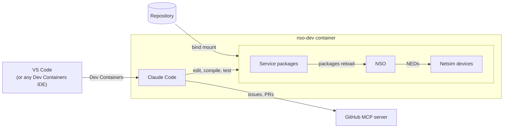

# 🔬 Worked example: NSO service packages

[← Back to the pillars](../README.md)

This repository applies the [pillars](../README.md) to Cisco NSO service development. Join the
project and start coding services right away, without days of fighting scattered docs,
mismatched libraries and broken sources.

## ✨ What you get

- 🤝 **The same environment for the whole team:** the same NSO version, NEDs, packages and lab
- 🚀 **Build once, use many times:** artifacts are downloaded once into an image, and you can start
  as many containers from it as you like
- 🚢 **Based on official NSO:** the official container image is extended, not modified
- 🧪 **A lab included:** six netsim devices (IOS XR, IOS, ASA), onboarded and synced on first start
- 🤖 **AI with shared rules:** Claude Code reads the team's NSO standards from the repository,
  enforces them with hooks, and tracks work through the GitHub MCP server

## 🗺️ What runs where

Your service code lives on the host and is bind-mounted into the container, so edits show up as
diffs in your repository. NSO, the netsims, Claude Code and the tests all run in the single
`nso-dev` container. Only Claude Code's calls to the Anthropic API and to the GitHub MCP server
leave your machine.

## 🧭 Where to go next

| I want to… | Read |
|------------|------|
| Get the environment running | [🚀 Set up the environment](./setup.md) |
| Build services with Claude Code | [🤖 Work with Claude Code](./working-with-claude.md) |
| Use Cursor, Windsurf, JetBrains or just a terminal | [🧭 Using another editor](./reference/editors.md) |
| Understand or change how the container is built | [⚙️ Under the hood](./reference/internals.md) |

## 📚 NSO references

- [Cisco NSO documentation](https://nso-docs.cisco.com/)
- [Service Development Guide](https://nso-docs.cisco.com/guides/development/introduction-to-automation/develop-a-simple-service)
- [DEVNET-2224: DevOps for NSO](https://github.com/ponchotitlan/embracing-devops-nso-usecase-lifecycle)
