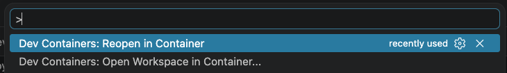
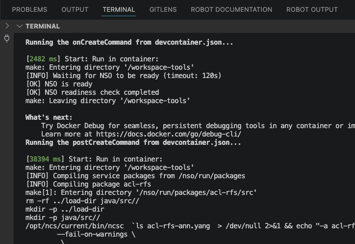
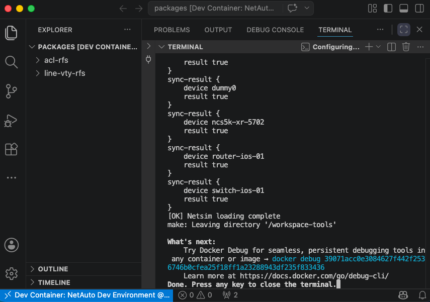
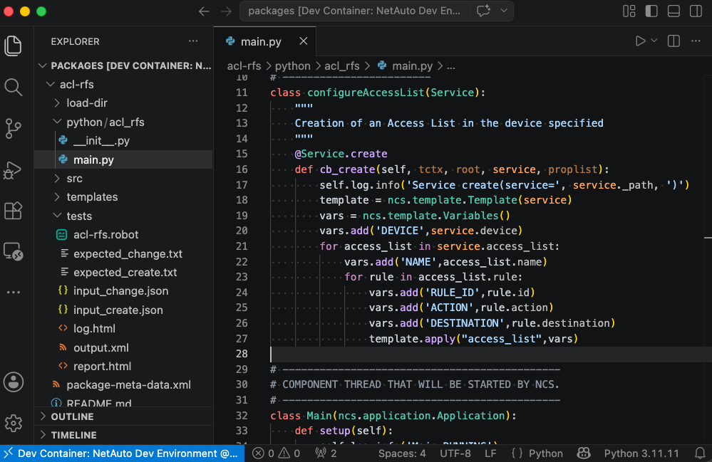
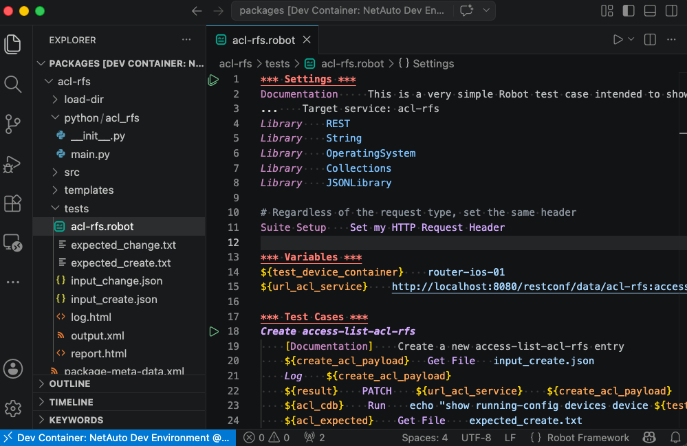
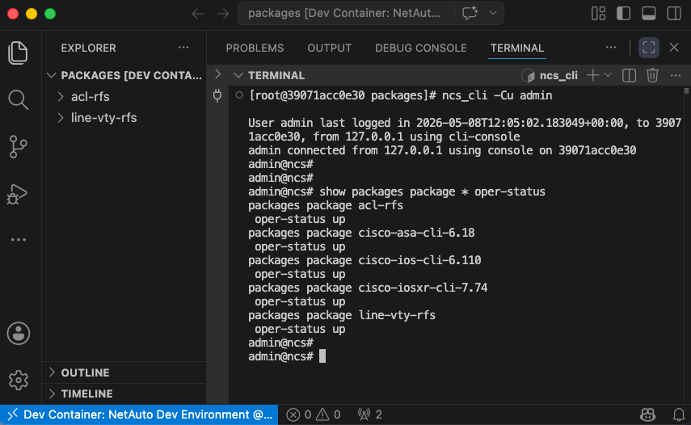
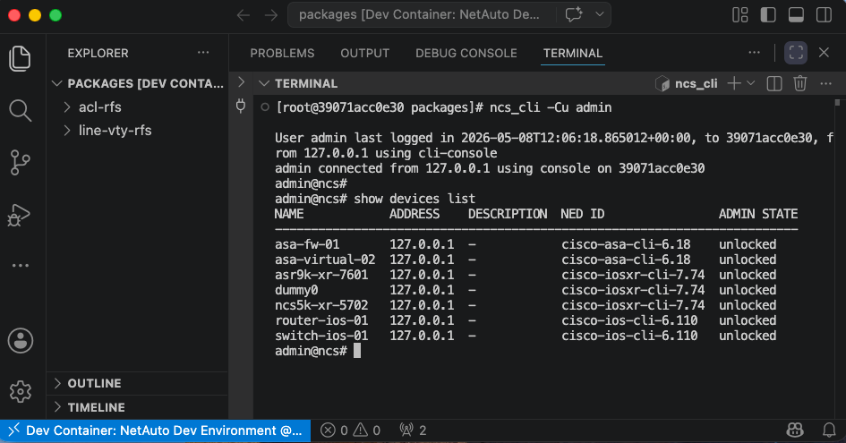

# 🚀 Set up the environment

[← NSO example](./nso-service-packages.md)

You do steps 1–3 once per team, to build the shared image. Each engineer does steps 4–5 once
per machine. After that, opening the editor is all it takes.

## ✅ Prerequisites

- [Docker](https://docs.docker.com/get-docker/) with [Docker Compose](https://docs.docker.com/compose/install/)
- [Make](https://www.gnu.org/software/make/)
- A Linux-based environment, or a Linux-compatible container runtime
- [VS Code](https://code.visualstudio.com/) with the [Dev Containers extension](https://marketplace.visualstudio.com/items?itemName=ms-vscode-remote.remote-containers).
  Other editors work too: see [Using another editor](./reference/editors.md).

```bash
git clone https://github.com/ponchotitlan/netops-ai-dev-environment
cd netops-ai-dev-environment
cp .env.example .env
```

## 1. Load the official NSO image

Download an official NSO container image, for example the free trial from
[software.cisco.com](https://software.cisco.com), and load it into Docker:

```bash
sh nso-6.5-freetrial.container-image-prod.linux.x86_64.signed.bin   # unpack the signed file
docker load < nso-6.5.container-image-prod.linux.x86_64.tar.gz
docker images | grep cisco-nso-prod                                  # verify
```

## 2. Choose your NEDs and Python libraries

- [`artifacts.yaml`](../artifacts.yaml): URLs of the NEDs and other binaries to bake into the image.
  Ideally they come from an authenticated artifact server.

  ```yaml
  urls:
    - https://github.com/ponchotitlan/dummy_artefact_repository/releases/download/iosxr6.6/ncs-6.6-cisco-iosxr-7.74.4.tar.gz
  ```

- [`requirements.txt`](../requirements.txt): Python libraries for the image. The defaults cover
  Robot Framework (for the tests) and `ruff` (for the coding-standard hooks).

## 3. Build and push the image

Fill these variables in `.env`:

| Variable | What it is |
|----------|------------|
| `NSO_BASE` | The official image from step 1, for example `ghcr.io/ponchotitlan/cisco-nso-prod:6.6` |
| `NSO_IMAGE` | Name and tag of your team's image, for example `ghcr.io/ponchotitlan/nso-dev:6.6.1` |
| `DOCKER_REGISTRY`, `DOCKER_REGISTRY_USER`, `DOCKER_REGISTRY_TOKEN` | Registry to push to (this demo uses `ghcr.io`) |

```bash
make build-push
```

The [`Dockerfile`](../Dockerfile) extends the official image without modifying it. See
[what it does](./reference/internals.md#-dockerfile).

## 4. Configure your instance

Fill the rest of `.env`:

| Variable | What it is |
|----------|------------|
| `ADMIN_USERNAME`, `ADMIN_PASSWORD` | NSO admin login (default `admin` / `admin`) |
| `NSO_HTTP_PORT`, `NSO_SSH_PORT` | Host ports for NSO HTTP and SSH (default `8080` / `2022`) |
| `GITHUB_PAT` | Fine-grained GitHub token with read/write on Contents, Issues, Pull requests and Projects, for the GitHub MCP server. Contents is what lets `/ship-it` push the branch |
| `GITHUB_REPOSITORY` | The repository Claude Code tracks work in, as `owner/repo` |

Then list your lab devices in [`nso-lab-topology.yaml`](../nso-lab-topology.yaml). The NED name
and version must match one of the artifacts in your image:

```yaml
topology:
  cisco-iosxr-cli:
    ned_version: "7.74.4"
    netsims:
      - asr9k-xr-7601
      - ncs5k-xr-5702
```

> **Behind a TLS-inspecting proxy?** `docker-compose-override.yml` mounts `certs/cisco-ca.pem` so
> that Claude Code trusts the corporate CA. Put your CA certificate there before you start the
> container.

## 5. Open it in a container

In VS Code, press `Cmd + Shift + P` (`Ctrl + Shift + P` on Windows/Linux) and run
**Dev Containers: Reopen in Container**.



The first start takes a few minutes. It waits for NSO, compiles your packages, loads the
preconfiguration, creates the netsims, syncs them, and installs Claude Code. This happens only
when the container is created. Closing the window pauses the container, and reopening the folder
resumes it.

### You're ready when

- VS Code opens in `/nso/run/packages`, which is your `source/packages/` folder. Edits show up as
  diffs in the repository.
- `show packages package oper-status` shows every package `up`.
- `show devices list` shows your netsims, reachable and in sync.

<details>
<summary>Screenshots of a successful start</summary>








</details>

**Next:** [Work with Claude Code →](./working-with-claude.md)
