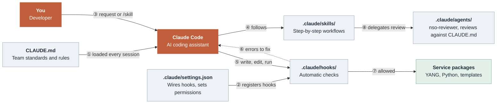

# 🤖 Work with Claude Code

[← NSO example](./nso-service-packages.md)

The team's NSO standards are Claude Code project files: the rules, plus checks that run on every
edit. They're mounted into the container, so Claude Code sees them whether you use the VS Code
panel or run `claude` in the container terminal.

## A day with it

| You run | What happens |
|---------|--------------|
| `/start-my-day` | Shows your issues for the sprint (from GitHub), checks that packages are up and netsims are in sync, and suggests a first task |
| `/new-service <name> <what>` | Scaffolds a package with `ncs-make-package`, then writes YANG, template, Python and a Robot test to the standards |
| *Plain requests*, e.g. "add IPv6 to the ACL service" | Claude Code edits the package. The hooks check every change |
| `/reload-packages` | Compiles, reloads and checks every package is `up`. If one isn't, it shows the error and the Python VM log |
| `/test-service <name>` | Runs the package's Robot tests and explains any failures |
| `/ship-it` | Lint, compile, reload, test, then a review by the `nso-reviewer` agent. Ends with the commit commands for your host and the pull request |

> The repository's `.git` isn't mounted in the container, so you commit and push from a terminal
> on the host. `/ship-it` gives you the exact commands.

## How the pieces fit

1. **Session start:** Claude Code loads `CLAUDE.md` and `.claude/settings.json`. The rules are in
   context and the hooks are registered before you type anything.
2. **You ask:** a plain request or a skill. If a skill matches the task, Claude Code follows its
   steps.
3. **Every write, edit or command goes through the hooks.** If a hook reports a problem (dashed
   arrow), Claude Code fixes it and tries again until the checks pass.
4. **Review:** `/ship-it` hands the change to the `nso-reviewer` agent. It works in its own
   context with read-only tools.

## The rules: `CLAUDE.md`

[`CLAUDE.md`](../CLAUDE.md) holds what the team agreed on:

- `-cfs` / `-rfs` suffixes on every package and service, and the servicepoint naming
- Type hints and Google-style docstrings everywhere
- NSO practices: deterministic `cb_create` (FASTMAP), templates for device config, the
  transaction NSO gives you, `self.log` for logging
- How to compile, reload and test, and the branch, commit and PR conventions

To change a rule, edit `CLAUDE.md` in a pull request, like any other code.

## The checks: `.claude/hooks/`

Instructions can be forgotten; hooks can't. They run on every tool call and send problems back to
Claude Code:

| When | Check |
|------|-------|
| Before writing a file or running `ncs-make-package` | Package names without `-cfs` / `-rfs` are blocked |
| After editing Python | `ruff format` + `ruff check --fix` with the rules in `ruff.toml` |
| After editing YANG | The package is compiled with `ncsc` |
| After editing anything in a package | Template `{$VARS}` match `vars.add()` calls, `template.apply("x")` has `templates/x.xml`, servicepoints match between YANG and `register_service()`, and `package-meta-data.xml` points at a real class |

> The example packages predate these rules. The first time Claude Code edits one of their files,
> the hooks ask it to add the missing type hints and docstrings.

## Permissions and GitHub

- **Permissions** (`.claude/settings.json`): Claude Code can compile, lint, run tests and read
  GitHub without asking. It asks before it touches NSO with `ncs_cli` or writes to GitHub.
- **GitHub MCP server** (`.mcp.json`): connects to GitHub's hosted server with your `GITHUB_PAT`
  for issues, pull requests and the project board. There's nothing to install. Ask things like
  *"what's assigned to me this sprint?"* or *"open the PR for this branch"*. Issue and PR
  templates are in `.github/`.

## Learn more

- [Claude Code documentation](https://code.claude.com/docs)
- [GitHub MCP server](https://github.com/github/github-mcp-server)
